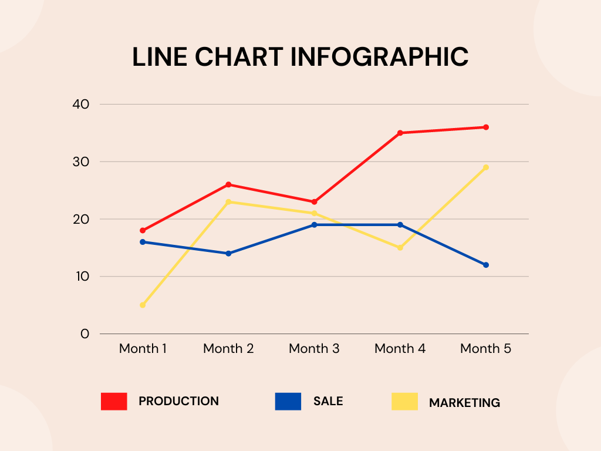
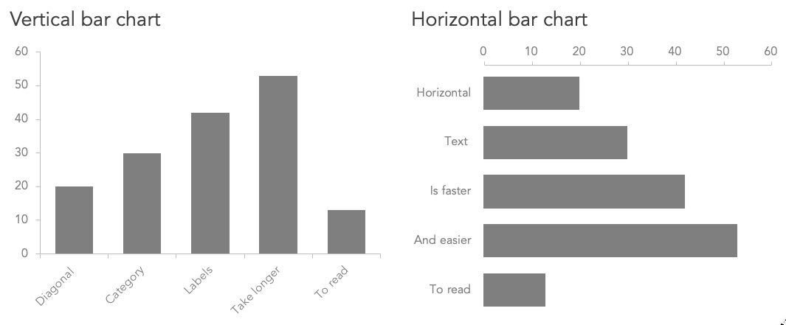
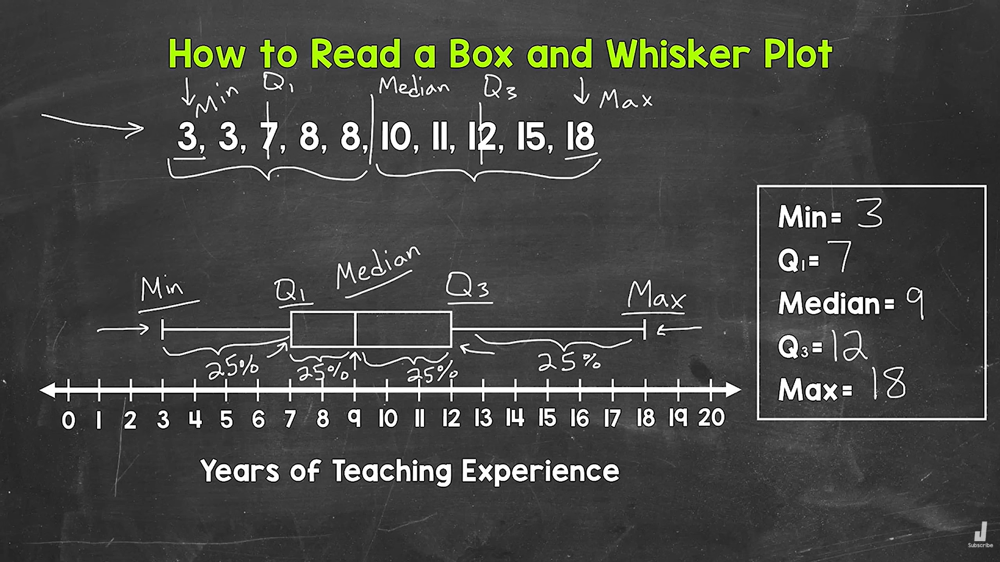
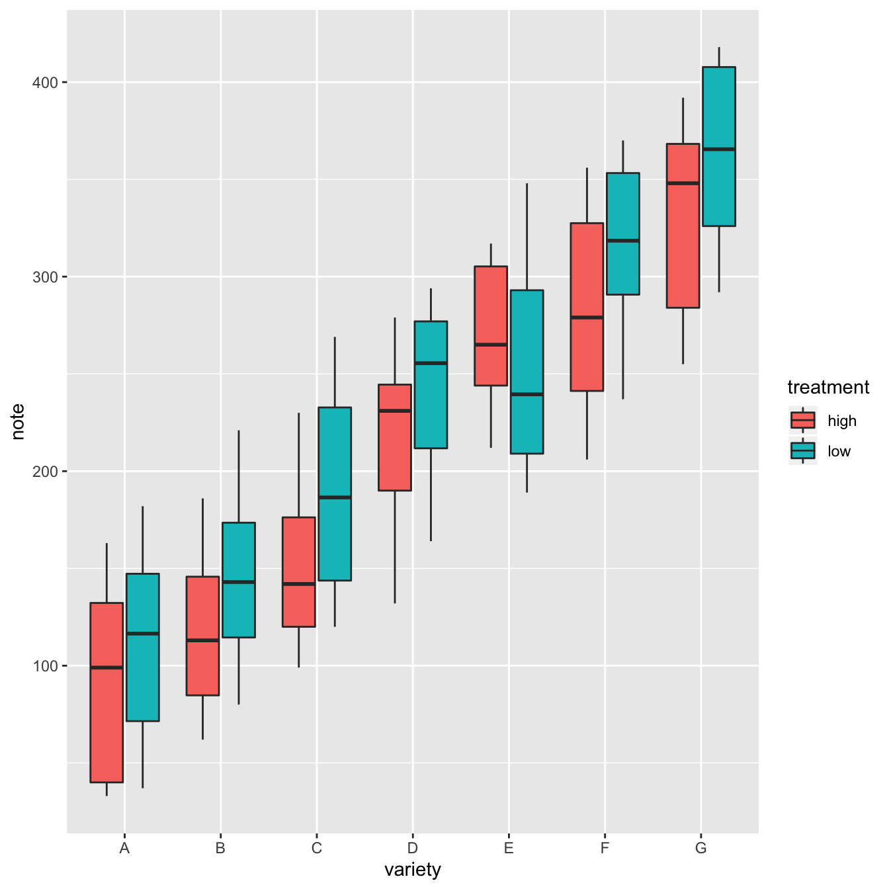
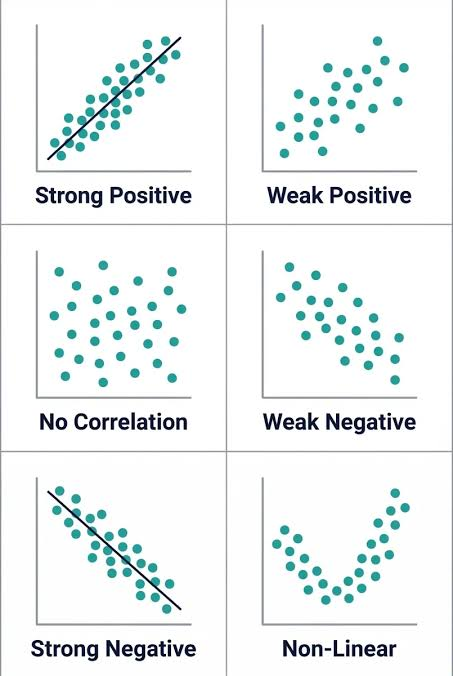
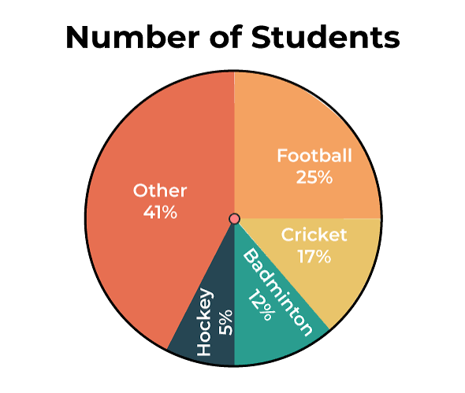
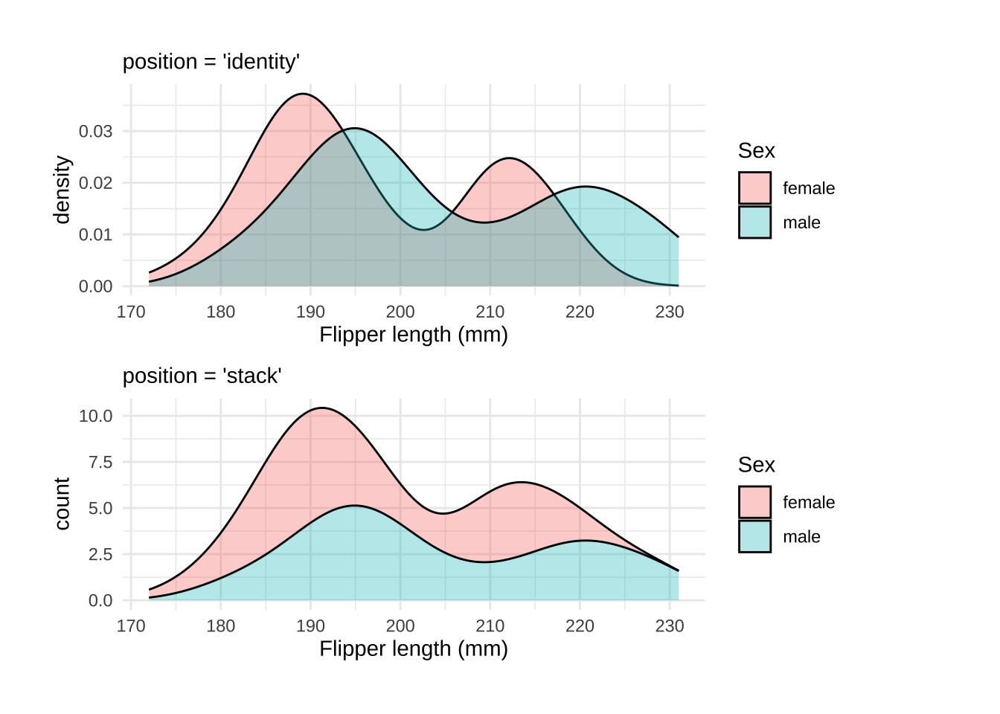
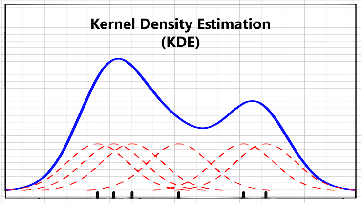

**Different types of plots :**  
1. Line Plot:  
- Any time when we want to see the trend or sequence or if we have the data with natural order or sequence.  
- The line's slope tells you the rate of change --> steep = fast change, flat = stable  
- Don't use for unordered categories (e.g., cities, names) — a line implies continuity/connection between points that doesn't exist for categorical data.  
  

2. Bar Chart :  
- We use it when we have to compare the values between different categories.   
- Variant — horizontal bar (barh): Use when category labels are long (e.g., full names) — avoids squished/rotated text on the x-axis.
   

3. Histogram :  
- Use Histogram when you have to look how the data is spread in the specific ranges.  
  
Difference between the Histogram and Bar chart:  
- bar graph have descrete/unordered categories but histogram have continuos numeric ranges(bins/buckets) that's why bar graph's representation of the categories have space between them but in histogram the bars are attached which shows the continuos representation.  
- in histogram the order of the numeric ranges matters but bar graph is unordered.  
- Bar graph represents any statistical data of the categories like counts,mean,etc. but histogram always represents the count/frequency of the data within the range.  
1[Histogram](images/histogram.jpg)   

4. Box Plot :  
- Similarly As histogram shows the variation of the data but we can plot multiple box plots side by side.  
  
HOW TO READ THE BOX PLOTS?? 
  

  

- We can see the multiple box plots representation in the live share market stock graph.  
- We can also show the outliers in the box plot using the isolated dots where each dot represents the single value of the outlier.  
  
5. Scatter Plot :  
- When we have to find out how the two numerical values are related with each other we use scatter plot.  
- each dot represents one row/observation 
- the X position of dot is one variables value and the Y position of dot is other variables value.  
- The overall pattern/shape of the dot cloud tells you the relationship:
     - Dots trending upward left→right → positive correlation
     - Dots trending downward → negative correlation
     - Dots scattered randomly, no pattern → no correlation
     - Dots forming a curve (not a straight line) → relationship exists but it's non-linear 
  
- Outliers — points far away from the main cloud  
- Clusters/groups — sometimes dots naturally separate into distinct clumps, hinting at subgroups in your data 

   
  
6. Pie Chart :  
- It shows the proportions of a whole --> How each category's share compares to the total (100%).    
- Each slice defines each category and percentage gives the exact proportions.  
  
  
7. Area Plot :  
- Same as a line plot, but the space under the line is filled with color.  
- With multiple columns, areas can stack on top of each other (stacked area = default) — so the top line represents the combined total, and each colored band shows that category's individual contribution  
- you also care about the magnitude/volume visually filled in.  
  
  
8. KDE Plot :  
- KDE is similar to histogram but histogram has sharp boundries like for ex. heights 150-160 and 160-170. if the height of a person is 159.9 then it falls into bucket 150-160 and the person with height 160.1 falls into next bucket instead the difference is only of 0.2.  
- Here, KDE comes it does not use buckets it gives a smooth density curve.  
- The core idea (this is the part everyone glosses over in videos)
        1. Take every single data point you have (every person's height).
        2. On top of each individual point, draw a small smooth bump (like a tiny hill, shaped like a bell curve).
        3. Now add up all these little bumps together — literally stack their heights on top of each other, mathematically.
        4. The result is one big smooth curve — tall where lots of little bumps overlapped (i.e., where you had lots of data points close together), and low where there weren't many points nearby.
  
Why is it called "Kernel" Density Estimate?  
- "Density" — it's showing you where data is densely packed vs sparse. Just like population density on a map — crowded cities vs empty countryside.  
- "Estimate" — you don't actually know the true underlying pattern of how heights are distributed in the whole world; you're just estimating/guessing it based on the limited sample of data you collected.  
- "Kernel" — this is just the technical name for that small bump shape you place on top of each data point. The word "kernel" here just means "the little bump function." (Different kernel shapes exist — bell-curve-shaped is the most common default — but you don't need to worry about the math behind it as a beginner.)  
  
- The y-axis of a KDE plot is NOT a count (unlike a histogram, where y-axis = "how many people").  

- The y-axis in KDE is called "density" — and its actual value isn't meant to be read directly (numbers like 0.02 or 0.15 mean nothing on their own). What matters is only the shape — where it's tall vs where it's short, and comparing regions to each other. Also, the whole area under the entire curve always adds up to exactly 1 (this is a mathematical rule) — it's about relative proportion, not raw counts.  

- This is exactly why people say "KDE shows a smoothed probability-like shape, not exact counts" — and why the numbers on a KDE's y-axis are honestly not something you should try to interpret literally as a beginner. Just look at the shape.  
  


**Plotting the graphs by using Pandas :**  
  
```python
df.plot(
    kind='line',        # chart type — see table below
    x=None,              # column for x-axis (optional — uses index if omitted)
    y=None,               # column(s) for y-axis
    figsize=(10, 6),       # width, height in inches
    title='My Chart',       # chart title
    xlabel='X Axis',         # x-axis label
    ylabel='Y Axis',          # y-axis label
    color='blue',              # single color, or list for multiple series
    grid=True,                  # show gridlines
    legend=True,                 # show legend
    subplots=False,               # separate subplot per column if True
    rot=0,                         # rotate x-axis tick labels (degrees)
    fontsize=10,                     # tick label font size
    ax=None                            # pass an existing matplotlib Axes to draw on
)
```
  
1. Line Plot  
```python
df.plot(kind='line', x='month', y='sales', marker='o', linestyle='--', linewidth=2)  
```
  
```
Parameter	                              Meaning
  x, y	              Columns to plot (y can be a list for multiple lines)
  marker	          Point style: 'o', 's', '^', 'x'
  linestyle	          '-' solid, '--' dashed, ':' dotted, '-.' dash-dot
  linewidth	          Line thickness
```

- line is default kind.  

2. Bar Chart  
```python
df.plot(kind='bar', x='city', y='sales', color='skyblue', width=0.8)
df.plot(kind='barh', x='city', y='sales')   # horizontal
```
```
   Parameter	                      Meaning
kind='bar'/'barh'	          Vertical / horizontal
width	              Bar width (0 to 1, relative to spacing) — default 0.5
stacked	              True to stack multiple columns into one bar instead of side-by-side
```
  
```python
df.plot(kind='bar', y=['sales','profit'], stacked=True)   # stacked bars
```
  
3. Histogram  
```python
df['age'].plot(kind='hist', bins=10, edgecolor='black', alpha=0.7)
```
```
Parameter	                                 Meaning
  bins	                        Number of buckets — key parameter, try a few values
edgecolor	                    Border color around each bar (helps distinguish adjacent bars)
  alpha	            Transparency (0 = invisible, 1 = solid) — useful when overlaying multiple histograms
 density	              If True, normalizes so total area = 1 (like KDE scale) instead of raw counts
```
Overlaying Two Histograms :  
```python
df['age'].plot(kind='hist', bins=15, alpha=0.5, label='Age')
df['salary'].plot(kind='hist', bins=15, alpha=0.5, label='Salary')
plt.legend()
```
  
4. Box Plot  
```python
df[['sales','profit']].plot(kind='box', vert=True, grid=True)
```
```
Parameter	                              Meaning
  vert	                   True = vertical boxes (default), False = horizontal
  by	                       Group by a column (used with df.boxplot(), see below)
```
```python
df.boxplot(column='salary', by='department')
```
  
5. Scatter Plot  
```python
df.plot(kind='scatter', x='sales', y='profit', s=50, c='red', alpha=0.6)
```
```
Parameter	                                     Meaning
  x, y	                             Required — exactly two numeric columns
   s	                    Marker size (can be a number, or a column name for variable-sized points)
   c	 Marker color (can be a single color, or a column name to color-code points by a third variable)
  alpha	                          Transparency — useful when points overlap heavily
 colormap	                     Color gradient scheme when c is a numeric column, e.g. 'viridis'  
```
```python
df.plot(kind='scatter', x='sales', y='profit', c='age', colormap='viridis')   # 3 variables at once
```
  
6. Pie Chart  
```python
df.set_index('city')['sales'].plot(kind='pie', autopct='%1.1f%%', startangle=90, shadow=False)
```
```
Parameter	                               Meaning
autopct	               Format string to display percentage on slices, e.g. '%1.1f%%'
startangle	                   Rotates where the first slice begins (degrees)
labels	                          Custom slice labels (defaults to index)
colors	                               List of colors, one per slice
explode	               List of offsets to "pull out" specific slices, e.g. [0, 0.1, 0]
```
Note: needs a Series (single column), not a DataFrame — hence .set_index(...)['col'].  
  
7. Area Plot  
```python
df.plot(kind='area', x='month', y=['sales','profit'], stacked=True, alpha=0.5)
```
```
Parameter	                            Meaning
stacked	              True (default) stacks series; False overlaps them
alpha	                      Transparency of the filled region
```

8. KDE Plot  
```python
df['age'].plot(kind='kde', bw_method=0.3, color='green')
```
```
Parameter	                                         Meaning
bw_method	                    "Bandwidth" — controls smoothness. Lower = more wiggly/detailed curve, 
                                            higher = smoother/flatter. Try 0.1 to 1 and compare
ind	                                 Number of points used to draw the curve (resolution)
```
Overlay histogram + KDE together (very common combo):  
```python 
df['age'].plot(kind='hist', bins=15, density=True, alpha=0.5)
df['age'].plot(kind='kde', color='red')
plt.show()
```
density=True on the histogram is required here — it rescales the histogram to match KDE's density scale so both fit on the same axis meaningfully.  
  
Common finishing touches (matplotlib, applied after any .plot()) :  
```python
ax = df.plot(kind='bar', x='city', y='sales')

ax.set_title('Sales by City')
ax.set_xlabel('City')
ax.set_ylabel('Sales ($)')
ax.legend(loc='upper right')
plt.xticks(rotation=45)
plt.tight_layout()          # prevents label cutoff
plt.savefig('chart.png', dpi=300)   # save to file
plt.show()                   # display (needed outside Jupyter)
```
   
